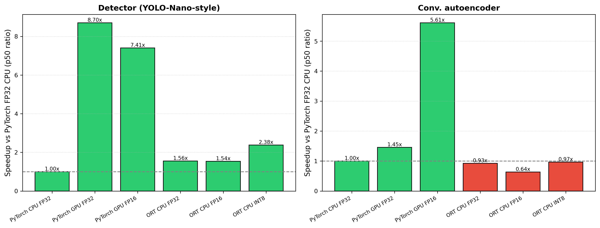
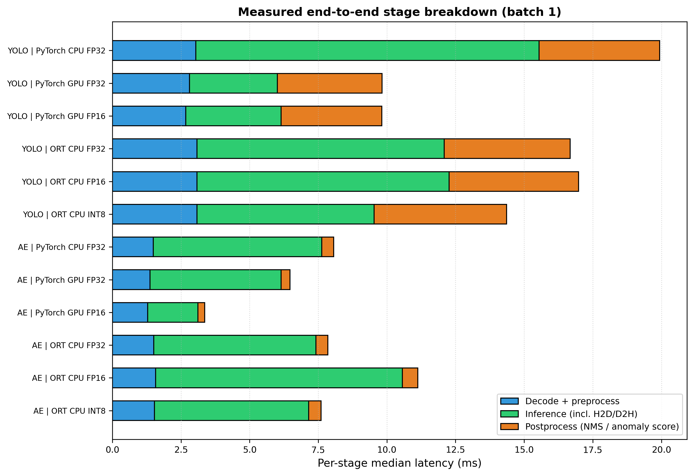
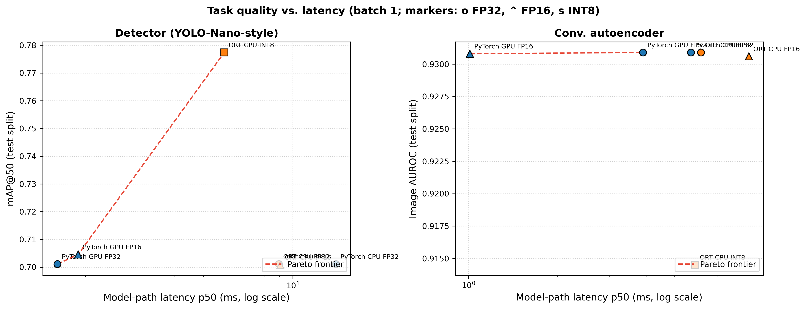
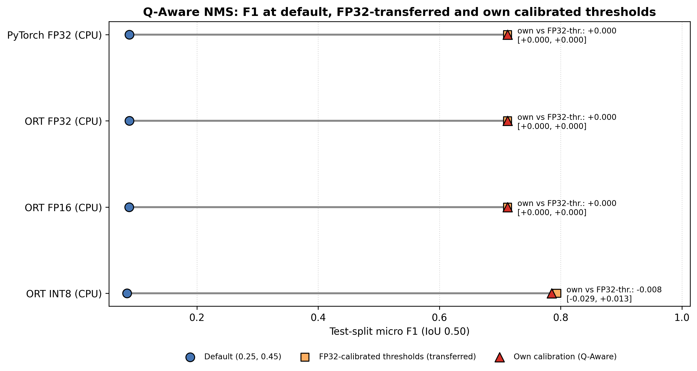
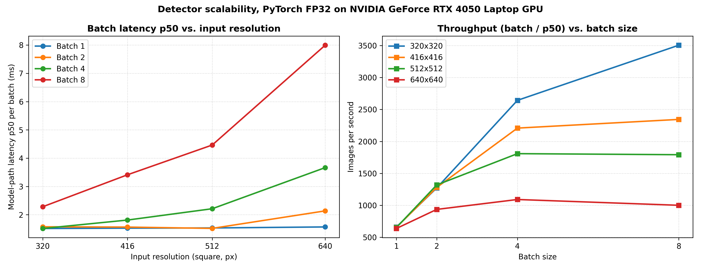

# ONNX Edge Inference Benchmark

**Reproducible latency, numerical-parity and task-quality benchmark of PyTorch vs ONNX Runtime at FP32, FP16 and
static INT8 — with quantization-aware post-processing (Q-Aware NMS) and detection-level flip attribution.**

[](https://github.com/sengarutk/onnx-quant-benchmark/actions/workflows/ci.yml)
[](LICENSE)


Every number below is produced by `make pipeline` and injected from `results/` by `scripts/update_readme.py`;
nothing is hand-copied. The run records of the published session are in [`results/runs.json`](results/runs.json).

## Key findings (session `session_20261027T011458Z`, RTX 4050 Laptop GPU + Core i5-13450HX, WSL2)

1. **ONNX Runtime is the faster CPU path for the detector, not for the autoencoder.** ORT FP32 runs the detector
   1.56x faster than PyTorch on the same CPU (8.98 vs 13.98 ms p50), but the autoencoder 0.93x (6.13 vs 5.68 ms).
2. **Static INT8 is model-dependent.** For the detector it gives 1.53x over ORT FP32 and a 73.6% smaller file, but its
   outputs deviate (max relative error 0.20) and it fails the pre-set numerical-parity gate, even though test mAP@50
   *rose* (0.701 to 0.777) because the quantized scores re-rank low-confidence boxes. For the autoencoder it is 74.3%
   smaller, only 1.04x faster, and costs 0.016 image AUROC (within the 0.02 gate).
3. **"FP32" on a modern GPU silently means TF32 unless disabled.** PyTorch's default cuDNN TF32 path broke parity
   (rel. error 1.05e-4); with strict FP32 the autoencoder runs 3.9x slower than FP16 (3.90 vs 1.01 ms).
4. **Model latency is not the bottleneck end to end.** For the detector on GPU, the model-path p50 is 1.61 ms, but the
   end-to-end p50 is 10.2 ms: decode + preprocess 2.8 ms, inference incl. copies 3.2 ms, NMS 3.8 ms (measured per stage).
5. **Quantization-aware NMS calibration does not beat transferring the FP32-calibrated thresholds.** Re-tuning the
   (confidence, IoU) thresholds lifts detector F1 from 0.09 to 0.71 for every precision (the default 0.25/0.45 is badly
   calibrated for this model), but INT8-specific thresholds change F1 by -0.008 [95% CI -0.029, +0.013] versus the
   FP32-calibrated ones (Holm-corrected p = 0.35) - no measurable precision-specific benefit.
6. **INT8 changes individual decisions far more than aggregate metrics suggest:** at calibrated thresholds 27.3% of
   detection decisions differ from FP32 (227 flips, 78% of them false-positive changes), while FP16 changes none.

---

## What is measured

For each *(model × runtime × precision)* configuration, one benchmark session records:

| Dimension | How |
| --- | --- |
| **Model-path latency** | 5 sessions × (50 warmup + 300 timed) passes on device-resident input; CUDA events on GPU, `perf_counter_ns` on CPU; percentiles pooled over sessions with bootstrap 95% CIs |
| **Stability** | CV of the session medians (≤ 0.05 = stable); 2 supplemental sessions if CV > 0.04 |
| **End-to-end latency** | decode → preprocess → inference (incl. host↔device copies) → NMS / anomaly scoring, **each stage timed** |
| **Numerical parity** | every output tensor vs PyTorch FP32 on CPU (max relative error, cosine), gated per precision |
| **Task quality** | the full test split re-evaluated **through the runtime under test** (mAP@50 / image AUROC), gated per precision |
| **Memory / size** | peak PyTorch CUDA allocation, process RSS, serialized model size |

Gates live in [`configs/`](configs/) and were fixed before the published run. Details: [`docs/methodology.md`](docs/methodology.md).

### Workloads

| Model | Task | Architecture | Input → output | Trained on |
| --- | --- | --- | --- | --- |
| `yolo_nano` | 2-class detection (rectangle / ellipse) | anchor-free, 5-stage Conv-BN-SiLU backbone, heads at strides 8/16/32, FCOS-style decoding in-graph, Quality Focal + GIoU loss | `[1,3,640,640]` → `[1,6,8400]` | procedural synthetic scenes |
| `industrial_autoencoder` | unsupervised surface-defect detection | strided-conv encoder, 1×1 bottleneck, transposed-conv decoder; score = smoothed top-k reconstruction error | `[1,3,256,256]` → reconstruction + anomaly map | defect-free synthetic textures |

Both models are **trained from scratch** by `scripts/train_models.py` on procedurally generated data with disjoint
train / validation / calibration / test splits ([`src/data/synthetic.py`](src/data/synthetic.py)). They are small on
purpose: the benchmark studies runtimes, precisions and measurement methodology, not state-of-the-art accuracy.

---

## Results

### Latency and stability (batch 1, model path pooled over sessions)

<!-- BEGIN:table2_latency_throughput -->
| Model | Runtime | Provider | Precision | Model p50 (ms) [95% CI] | Model p95 (ms) | Model p99 (ms) | E2E p50 (ms) | Model FPS (1/p50) | Session CV | Stable (CV<=0.05) |
| --- | --- | --- | --- | --- | --- | --- | --- | --- | --- | --- |
| yolo_nano | PyTorch | PyTorch_CPU | FP32 | 13.983 [13.948, 14.050] | 18.088 | 19.797 | 20.60 | 71.5 | 0.011 | yes |
| yolo_nano | PyTorch | PyTorch_CUDA:0 | FP32 | 1.607 [1.597, 1.615] | 3.594 | 4.258 | 10.21 | 622.4 | 0.051 | no |
| yolo_nano | PyTorch | PyTorch_CUDA:0 | FP16 | 1.888 [1.882, 1.892] | 4.568 | 5.124 | 10.15 | 529.6 | 0.013 | yes |
| yolo_nano | ORT_CPU | CPUExecutionProvider | FP32 | 8.976 [8.943, 9.009] | 11.855 | 12.715 | 17.67 | 111.4 | 0.016 | yes |
| yolo_nano | ORT_CPU | CPUExecutionProvider | FP16 | 9.077 [9.047, 9.113] | 12.334 | 13.388 | 18.05 | 110.2 | 0.015 | yes |
| yolo_nano | ORT_CPU | CPUExecutionProvider | INT8 | 5.876 [5.847, 5.911] | 6.999 | 7.624 | 14.62 | 170.2 | 0.008 | yes |
| industrial_autoencoder | PyTorch | PyTorch_CPU | FP32 | 5.675 [5.650, 5.712] | 7.292 | 8.192 | 8.09 | 176.2 | 0.023 | yes |
| industrial_autoencoder | PyTorch | PyTorch_CUDA:0 | FP32 | 3.902 [3.900, 3.905] | 4.140 | 4.491 | 6.50 | 256.2 | 0.002 | yes |
| industrial_autoencoder | PyTorch | PyTorch_CUDA:0 | FP16 | 1.012 [1.008, 1.018] | 1.452 | 3.243 | 3.39 | 988.4 | 0.020 | yes |
| industrial_autoencoder | ORT_CPU | CPUExecutionProvider | FP32 | 6.133 [6.115, 6.159] | 7.832 | 9.117 | 7.90 | 163.0 | 0.008 | yes |
| industrial_autoencoder | ORT_CPU | CPUExecutionProvider | FP16 | 8.921 [8.897, 8.947] | 10.456 | 11.994 | 11.17 | 112.1 | 0.006 | yes |
| industrial_autoencoder | ORT_CPU | CPUExecutionProvider | INT8 | 5.875 [5.831, 5.917] | 7.366 | 9.188 | 7.66 | 170.2 | 0.029 | yes |
<!-- END:table2_latency_throughput -->




### Numerical parity vs PyTorch FP32 (CPU)

<!-- BEGIN:table1_numerical_correctness -->
| Model | Runtime | Provider | Precision | Max abs. error | Max rel. error | Min cosine sim. | Parity gate |
| --- | --- | --- | --- | --- | --- | --- | --- |
| yolo_nano | PyTorch | PyTorch_CPU | FP32 | 0.000e+00 | 0.000e+00 | 1.000000 | PASS |
| yolo_nano | PyTorch | PyTorch_CUDA:0 | FP32 | 2.747e-04 | 4.197e-07 | 1.000000 | PASS |
| yolo_nano | PyTorch | PyTorch_CUDA:0 | FP16 | 1.385e+00 | 2.117e-03 | 1.000000 | PASS |
| yolo_nano | ORT_CPU | CPUExecutionProvider | FP32 | 3.586e-04 | 5.479e-07 | 1.000000 | PASS |
| yolo_nano | ORT_CPU | CPUExecutionProvider | FP16 | 3.877e-01 | 5.925e-04 | 1.000000 | PASS |
| yolo_nano | ORT_CPU | CPUExecutionProvider | INT8 | 1.323e+02 | 2.022e-01 | 0.999255 | FAIL |
| industrial_autoencoder | PyTorch | PyTorch_CPU | FP32 | 0.000e+00 | 0.000e+00 | 1.000000 | PASS |
| industrial_autoencoder | PyTorch | PyTorch_CUDA:0 | FP32 | 2.980e-07 | 1.562e-06 | 1.000000 | PASS |
| industrial_autoencoder | PyTorch | PyTorch_CUDA:0 | FP16 | 6.398e-04 | 3.727e-03 | 0.999986 | PASS |
| industrial_autoencoder | ORT_CPU | CPUExecutionProvider | FP32 | 2.384e-07 | 1.206e-06 | 1.000000 | PASS |
| industrial_autoencoder | ORT_CPU | CPUExecutionProvider | FP16 | 3.764e-04 | 1.862e-03 | 0.999995 | PASS |
| industrial_autoencoder | ORT_CPU | CPUExecutionProvider | INT8 | 1.658e-02 | 8.325e-02 | 0.992803 | PASS |
<!-- END:table1_numerical_correctness -->

### Task quality, re-measured through each runtime on the test split

Reference: detector mAP@50 0.701 (mAP@50-95 0.501), autoencoder image AUROC 0.931 (AU-PRO 0.801).

<!-- BEGIN:table4_quality_retention -->
| Model | Runtime | Provider | Precision | Metric | Value | FP32 reference | Delta | Quality gate |
| --- | --- | --- | --- | --- | --- | --- | --- | --- |
| yolo_nano | PyTorch | PyTorch_CPU | FP32 | mAP_50 | 0.7011 | 0.7011 | +0.0000 | PASS |
| yolo_nano | PyTorch | PyTorch_CUDA:0 | FP32 | mAP_50 | 0.7011 | 0.7011 | +0.0000 | PASS |
| yolo_nano | PyTorch | PyTorch_CUDA:0 | FP16 | mAP_50 | 0.7046 | 0.7011 | +0.0035 | PASS |
| yolo_nano | ORT_CPU | CPUExecutionProvider | FP32 | mAP_50 | 0.7011 | 0.7011 | +0.0000 | PASS |
| yolo_nano | ORT_CPU | CPUExecutionProvider | FP16 | mAP_50 | 0.7008 | 0.7011 | -0.0003 | PASS |
| yolo_nano | ORT_CPU | CPUExecutionProvider | INT8 | mAP_50 | 0.7774 | 0.7011 | +0.0763 | PASS |
| industrial_autoencoder | PyTorch | PyTorch_CPU | FP32 | image_auroc | 0.9309 | 0.9309 | +0.0000 | PASS |
| industrial_autoencoder | PyTorch | PyTorch_CUDA:0 | FP32 | image_auroc | 0.9309 | 0.9309 | +0.0000 | PASS |
| industrial_autoencoder | PyTorch | PyTorch_CUDA:0 | FP16 | image_auroc | 0.9308 | 0.9309 | -0.0001 | PASS |
| industrial_autoencoder | ORT_CPU | CPUExecutionProvider | FP32 | image_auroc | 0.9309 | 0.9309 | +0.0000 | PASS |
| industrial_autoencoder | ORT_CPU | CPUExecutionProvider | FP16 | image_auroc | 0.9306 | 0.9309 | -0.0003 | PASS |
| industrial_autoencoder | ORT_CPU | CPUExecutionProvider | INT8 | image_auroc | 0.9145 | 0.9309 | -0.0164 | PASS |
<!-- END:table4_quality_retention -->



### Reduced-precision artifacts

<!-- BEGIN:table5_int8_quantization_audit -->
| Model | Runtime | Precision | Method | Size vs FP32 ONNX | Speedup vs same-runtime FP32 | Quality delta | Gates |
| --- | --- | --- | --- | --- | --- | --- | --- |
| yolo_nano | PyTorch (PyTorch_CUDA:0) | FP16 | FP16 cast (onnxconverter-common, FP32 I/O) | n/a | 7.41x | +0.0035 | PASS |
| yolo_nano | ORT_CPU (CPUExecutionProvider) | FP16 | FP16 cast (onnxconverter-common, FP32 I/O) | -49.9% | 0.99x | -0.0003 | PASS |
| yolo_nano | ORT_CPU (CPUExecutionProvider) | INT8 | Static QDQ, MinMax, symmetric, per-channel weights | -73.6% | 1.53x | +0.0763 | FAIL |
| industrial_autoencoder | PyTorch (PyTorch_CUDA:0) | FP16 | FP16 cast (onnxconverter-common, FP32 I/O) | n/a | 5.61x | -0.0001 | PASS |
| industrial_autoencoder | ORT_CPU (CPUExecutionProvider) | FP16 | FP16 cast (onnxconverter-common, FP32 I/O) | -49.9% | 0.69x | -0.0003 | PASS |
| industrial_autoencoder | ORT_CPU (CPUExecutionProvider) | INT8 | Static QDQ, MinMax, symmetric, per-channel weights | -74.3% | 1.04x | -0.0164 | PASS |
<!-- END:table5_int8_quantization_audit -->

The INT8 calibration method was selected per model on the calibration split (MinMax / Percentile / Entropy; see
[`docs/int8-calibration.md`](docs/int8-calibration.md)). With symmetric activation quantization, ONNX Runtime's Entropy
ranges collapse to the MinMax scales (the artifacts are byte-identical), so only MinMax vs Percentile actually differ.

### Q-Aware NMS ablation (calibration split -> test split, 200 images / 684 boxes)

<!-- BEGIN:table6_q_aware_nms_ablation -->
| Configuration | Calibrated (conf, IoU) | F1 default | F1 FP32-transfer | F1 own calibration | Delta vs default [95% CI] | p Holm | Delta vs FP32-transfer [95% CI] | p Holm | Post-proc. ms (default / calibrated) |
| --- | --- | --- | --- | --- | --- | --- | --- | --- | --- |
| PyTorch FP32 (CPU) | (0.80, 0.05) | 0.0885 | 0.7124 | 0.7124 | +0.6239 [+0.5857, +0.6603] | 9.49e-34 | +0.0000 [+0.0000, +0.0000] | 1 | 3.74 / 0.41 |
| ORT FP32 (CPU) | (0.80, 0.05) | 0.0885 | 0.7124 | 0.7124 | +0.6239 [+0.5857, +0.6603] | 9.49e-34 | +0.0000 [+0.0000, +0.0000] | 1 | 3.93 / 0.40 |
| ORT FP16 (CPU) | (0.80, 0.05) | 0.0883 | 0.7124 | 0.7124 | +0.6240 [+0.5857, +0.6604] | 9.49e-34 | +0.0000 [+0.0000, +0.0000] | 1 | 3.66 / 0.43 |
| ORT INT8 (CPU) | (0.75, 0.10) | 0.0849 | 0.7937 | 0.7853 | +0.7004 [+0.6647, +0.7344] | 8.35e-34 | -0.0083 [-0.0292, +0.0132] | 0.345 | 3.75 / 0.49 |
<!-- END:table6_q_aware_nms_ablation -->



### Decision-flip attribution vs PyTorch FP32

<!-- BEGIN:table7_decision_flip_audit -->
| Target vs PyTorch FP32 | Thresholds | Target boxes | Matched | Flip rate | Lost TPs | New TPs | New FPs | Suppressed FPs | FP share of flips |
| --- | --- | --- | --- | --- | --- | --- | --- | --- | --- |
| PyTorch FP32 (CPU) | default | 14185 | 14185 | 0.0000 | 0 | 0 | 0 | 0 | 0.0% |
| PyTorch FP32 (CPU) | calibrated | 731 | 731 | 0.0000 | 0 | 0 | 0 | 0 | 0.0% |
| ORT FP32 (CPU) | default | 14185 | 14185 | 0.0000 | 0 | 0 | 0 | 0 | 0.0% |
| ORT FP32 (CPU) | calibrated | 731 | 731 | 0.0000 | 0 | 0 | 0 | 0 | 0.0% |
| ORT FP16 (CPU) | default | 14193 | 14143 | 0.0065 | 0 | 1 | 49 | 42 | 98.9% |
| ORT FP16 (CPU) | calibrated | 731 | 731 | 0.0000 | 0 | 0 | 0 | 0 | 0.0% |
| ORT INT8 (CPU) | default | 14998 | 9854 | 0.4902 | 18 | 10 | 5134 | 4313 | 99.7% |
| ORT INT8 (CPU) | calibrated | 704 | 604 | 0.2732 | 11 | 38 | 62 | 116 | 78.4% |
<!-- END:table7_decision_flip_audit -->

### Scalability (PyTorch FP32 on GPU)

At batch 1 the detector is launch-bound: p50 stays at about 1.5 ms from 320 to 640 px. Batching raises throughput up to
3,505 img/s (320 px, batch 8) and 1,001 img/s at 640 px, batch 8 ([`results/scalability_sweep.csv`](results/scalability_sweep.csv)).



### Deployment decision matrix (generated)

<!-- BEGIN:deployment_decision_matrix -->
Generated by `src/analysis/decision_matrix.py` from a single benchmark session (`session_20261027T011458Z`). Only configurations that pass both the numerical-parity gate and the task-quality gate are eligible. Measurements are from the disclosed workstation testbed (batch size 1), not from embedded hardware.

| Scenario | Selection rule | Recommendation | Evidence |
| :--- | :--- | :--- | :--- |
| A. Lowest end-to-end latency, detector | min E2E p50 | PyTorch (PyTorch_CUDA:0) FP16 | E2E p50 10.15 ms (does NOT meet a 10 ms budget), model p50 1.888 ms, mAP@50 0.7046 (+0.0035) |
| B. CPU-only host, detector | min model p50 on CPU | ORT_CPU (CPUExecutionProvider) FP32 | model p50 8.976 ms (95% CI 8.943-9.009), 1.56x vs PyTorch FP32 CPU, mAP_50 0.7011 |
| B. CPU-only host, autoencoder | min model p50 on CPU | PyTorch (PyTorch_CPU) FP32 | model p50 5.675 ms (95% CI 5.650-5.712), 1.00x vs PyTorch FP32 CPU, image_auroc 0.9309 |
| C. Anomaly inspection, best image AUROC | max AUROC, then min E2E p50 | PyTorch (PyTorch_CUDA:0) FP32 | image AUROC 0.9309 (+0.0000 vs FP32 reference), E2E p50 6.50 ms |
| D. Smallest deployable artifact, yolo_nano | min serialized size | ORT_CPU (CPUExecutionProvider) FP16 | 3.76 MB (49.9% smaller than FP32 ONNX), mAP_50 delta -0.0003, 0.99x vs same-runtime FP32 |
| D. Smallest deployable artifact, industrial_autoencoder | min serialized size | ORT_CPU (CPUExecutionProvider) INT8 | 1.39 MB (74.3% smaller than FP32 ONNX), image_auroc delta -0.0164, 1.04x vs same-runtime FP32 |

## Configurations excluded by acceptance gates

- `yolo_nano` ORT_CPU (CPUExecutionProvider) INT8: numerical gate FAIL (max rel. error 2.02e-01, cosine 0.999255), quality gate PASS (mAP_50 delta +0.0763).

Note: 1 of 12 configurations exceeded the session-median CV threshold (see `cv_p50` in `results/runs.csv`); their latencies vary between sessions on this host.
<!-- END:deployment_decision_matrix -->

More figures: [stability](results/figures/stability_variance_trends.png), [tail latency](results/figures/tail_latency_p50_p95.png),
[memory and size](results/figures/memory_vs_footprint.png), [decision flips](results/figures/decision_flip_attribution.png).
Paper: [`paper/main.pdf`](paper/main.pdf).

---

## Reproduce

```bash
git clone https://github.com/sengarutk/onnx-quant-benchmark.git
cd onnx-quant-benchmark
python -m pip install -r requirements.txt
make pipeline        # data -> training -> export -> quantization -> benchmark -> report -> experiments -> paper
```

| Command | Purpose |
| --- | --- |
| `make data` / `make train` | synthetic splits; train both models (~15 min on an RTX 4050, CPU fallback) |
| `make export quantize validate` | ONNX export + parity audit, FP16 / INT8 artifacts + quality gates, backend checks |
| `make benchmark report` | one benchmark session → `results/runs.csv`, tables, figures, decision matrix, README tables |
| `make experiments` | Q-Aware NMS ablation + batch × resolution sweep |
| `make paper` | paper tables/macros from `results/`, `paper/main.pdf`, `overleaf_paper.zip` |
| `make smoke-test` / `make test` | quick end-to-end check (temp dir) / unit tests |

For GPU inference in ONNX Runtime install `onnxruntime-gpu` *instead of* `onnxruntime`; TensorRT engines are built
with `scripts/build_trt_engines.sh` when the `tensorrt` package is present. Unavailable back ends are recorded with the
reason in each session's `session.json`.

## Repository layout

```text
configs/            benchmark protocol + per-precision acceptance gates
src/data/           procedural synthetic datasets
src/models/         detector + autoencoder, preprocessing, post-processing
src/training/       losses and on-the-fly datasets
src/export/         ONNX export, validation, simplification
src/quantization/   FP16 / static INT8 PTQ, calibration reader, Q-Aware NMS, TensorRT builder
src/runtimes/       PyTorch, ONNX Runtime CPU/CUDA, TensorRT wrappers + fallback audit
src/benchmarking/   timers, stability analysis, memory, benchmark suite
src/validation/     detection / anomaly metrics, parity checks, task evaluation
src/analysis/       session aggregation, statistics (bootstrap, Wilcoxon, Holm), flips, decision matrix
src/experiments/    Q-Aware NMS ablation, scalability sweep
scripts/            pipeline stages (see Makefile)
results/            runs.csv / runs.json, tables/, figures/, baselines/, training/
paper/              manuscript (numbers via generated macros), figures, PDF
```

## Limitations

* Synthetic data and small models — results describe runtime/precision behavior, not real-world accuracy.
* One laptop testbed under WSL2 (hybrid-core CPU exposed as 8 cores / 16 threads); not an embedded/Jetson measurement.
* ONNX Runtime CUDA and TensorRT paths are implemented and tested, but were not available on the benchmark host.

## Version history

See [`CHANGELOG.md`](CHANGELOG.md). **v2.0.0 supersedes v1.x**, whose Q-Aware NMS, quality and stage-breakdown
results were not measured (erratum in the changelog).

## Citation

```bibtex
@software{sengar2026onnxbench,
  author  = {Utkarsh Sengar},
  title   = {ONNX Edge Inference Benchmark: PyTorch vs ONNX Runtime FP32/FP16/INT8 with Quantization-Aware Post-Processing},
  year    = {2026},
  version = {2.0.0},
  url     = {https://github.com/sengarutk/onnx-quant-benchmark}
}
```

License: [Apache 2.0](LICENSE).
